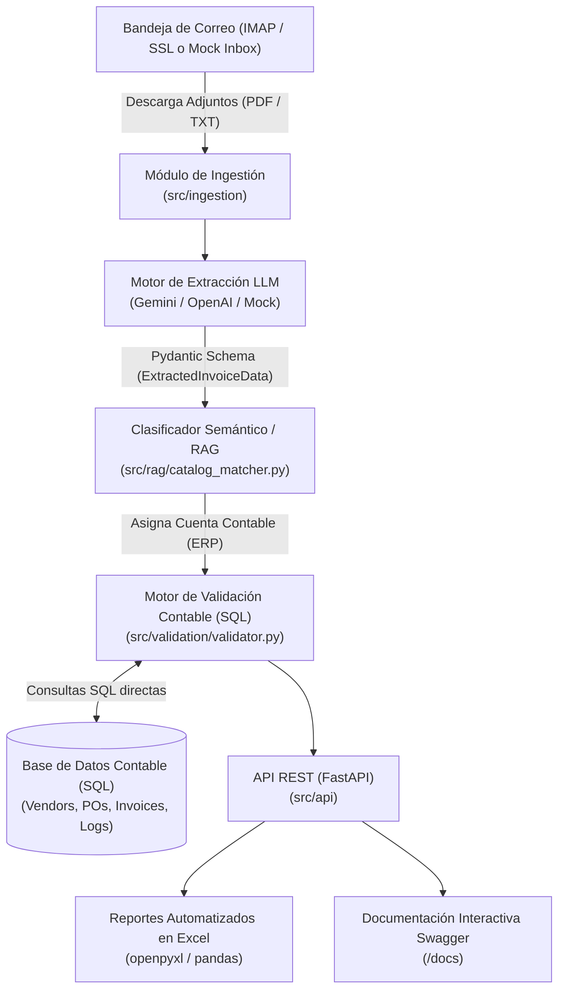

# Sistema Automatizado de Ingesta, Extracción con LLM y Validación Contable (SQL)

[](https://github.com)
[](https://www.python.org/)
[](https://fastapi.tiangolo.com/)
[](https://opensource.org/licenses/MIT)

Solución integral en Python diseñada para reemplazar el proceso manual de recepción de facturas por correo electrónico. El sistema monitorea la bandeja de entrada, descarga las facturas adjuntas, utiliza Inteligencia Artificial Generativa (LLMs) para estructurar la información, clasifica los conceptos mediante técnicas semánticas/RAG hacia el catálogo de cuentas contables del ERP, valida los datos mediante consultas directas a base de datos (SQL) y expone los resultados mediante una API REST documentada y reportes automáticos en Excel.

---

## 1. Arquitectura del Flujo



---

## 2. Competencias Técnicas Implementadas

* **Python & POO**: Patrón *Strategy* para desacoplar proveedores de LLM, inyección de dependencias, tipado estricto con `typing`, modelos fuertemente tipados con `Pydantic v2` y separación modular en capas.
* **IA Generativa & Prompt Engineering**:
  * Consumo de APIs para **Google Gemini** (`google-genai`) y **OpenAI**.
  * Prompt engineering con técnicas *Few-Shot* y validación estricta de esquemas JSON.
  * Extractor determinista (*Mock*) para testing continuo y entornos sin conexión o sin API keys.
* **Nociones de RAG & Embeddings**:
  * Módulo `SemanticCatalogMatcher`: Mapea descripciones libres de productos en facturas hacia el catálogo de cuentas contables del ERP mediante similitud de coseno y frecuencias de términos.
* **Datos e Integración (SQL)**:
  * Consultas SQL parametrizadas directas (`text(...)`) contra tablas relacionales:
    * `SQL_VENDOR_EXISTS` y `SQL_VENDOR_ACTIVE`: Valida alta y estatus del proveedor por RFC/Tax ID.
    * `SQL_DUPLICATE_CHECK`: Detección de duplicados por Folio Fiscal (UUID) o folio/proveedor.
    * `SQL_PO_MATCH`: Correlación con Órdenes de Compra abiertas y tolerancia porcentual de importes.
    * `ARITHMETIC_CHECKS`: Cuadre de suma de partidas contra subtotal e impuestos contra total.
* **Excel & Reportes**:
  * Reemplazo del copiado manual mediante `ExcelReportingService` (`openpyxl` / `pandas`), con estilos corporativos, formatos de moneda y colores condicionales según el estado de validación.
* **API REST (FastAPI)**:
  * Endpoints RESTful con documentación automática OpenAPI/Swagger (`/docs`) y ReDoc (`/redoc`).
* **DevOps, Docker & CI/CD**:
  * Contenedorización con `Dockerfile` y orquestación con `docker-compose.yml`.
  * Pipeline de Integración Continua con **GitHub Actions** (`.github/workflows/ci.yml`).
  * Control de versiones atómico y semántico en **Git**.

---

## 3. Estructura del Proyecto

```text
├── config/
│   ├── settings.py              # Configuración y variables de entorno (Pydantic / python-dotenv)
├── data/
│   ├── mock_inbox/              # Buzón simulado para pruebas locales offline
│   └── samples/                 # Facturas de muestra (válidas, duplicadas, con error aritmético)
├── src/
│   ├── api/
│   │   ├── routers/
│   │   │   ├── health.py        # Healthcheck y diagnóstico de base de datos
│   │   │   └── invoices.py      # Endpoints de sincronización, subida, consulta y Excel
│   │   ├── schemas.py           # Esquemas Pydantic de entrada y salida de la API
│   │   └── main.py              # Aplicación FastAPI y ciclo de vida
│   ├── database/
│   │   ├── connection.py        # Configuración del motor SQLAlchemy y sesiones
│   │   ├── models.py            # Modelos ORM relacionales (Vendors, POs, Invoices, Logs)
│   │   └── seed.py              # Script de siembra inicial con datos de prueba
│   ├── extraction/
│   │   ├── extractor.py         # Estrategias LLM (Gemini, OpenAI, Mock)
│   │   ├── prompts.py           # Prompt engineering y ejemplos few-shot
│   │   └── schemas.py           # Esquemas Pydantic para facturas extraídas
│   ├── ingestion/
│   │   ├── email_client.py      # Clientes IMAP SSL y Mock Ingestion
│   │   ├── models.py            # Modelos de mensajes y adjuntos
│   │   └── parser.py            # Extractor de texto de archivos PDF (pypdf) y texto
│   ├── rag/
│   │   └── catalog_matcher.py   # Clasificador semántico RAG para cuentas contables
│   ├── reporting/
│   │   └── excel_service.py     # Generador de reportes en Microsoft Excel estilizados
│   └── validation/
│       ├── rules.py             # DTOs de resultados y reglas
│       ├── validator.py         # Motor de validación SQL pura
│       └── service.py           # Servicio orquestador del flujo
├── tests/
│   ├── test_api.py              # Pruebas de integración de la API REST
│   ├── test_extraction.py       # Pruebas de extracción con LLM
│   ├── test_rag.py              # Pruebas del clasificador semántico
│   └── test_validation.py       # Pruebas del motor de reglas SQL
├── .github/workflows/ci.yml     # Pipeline de CI/CD para GitHub Actions
├── Dockerfile                   # Imagen Docker optimizada
├── docker-compose.yml           # Orquestación de contenedores
├── requirements.txt             # Dependencias del proyecto
└── README.md                    # Documentación técnica
```

---

## 4. Instalación y Puesta en Marcha

### Opción A: Entorno Local (Recomendado para Desarrollo)

1. **Clonar el repositorio:**
   ```bash
   git clone <URL_DEL_REPOSITORIO>
   cd "LLM for Email"
   ```

2. **Crear y activar el entorno virtual:**
   ```bash
   python -m venv .venv
   # En Windows:
   .\.venv\Scripts\activate
   # En Linux / macOS:
   source .venv/bin/activate
   ```

3. **Instalar dependencias:**
   ```bash
   pip install -r requirements.txt
   ```

4. **Configurar variables de entorno (`.env`):**
   El archivo `.env` ya viene preconfigurado con valores por defecto para operar de inmediato en modo offline/mock:
   ```env
   DATABASE_URL=sqlite:///./invoices.db
   LLM_PROVIDER=mock          # Cambiar a "gemini" o "openai" para usar APIs en vivo
   GEMINI_API_KEY=tu_api_key  # Requerido solo si LLM_PROVIDER=gemini
   EMAIL_SOURCE=mock          # Cambiar a "imap" para buzones reales
   ```

5. **Sembrar la base de datos contable:**
   ```bash
   python -m src.database.seed
   ```

6. **Iniciar el servidor web:**
   ```bash
   uvicorn src.api.main:app --reload --port 8000
   ```
   * **Dashboard Web Ejecutivo:** [http://localhost:8000](http://localhost:8000) (interfaz moderna para carga y auditoría)
   * **Documentación Técnica Swagger:** [http://localhost:8000/docs](http://localhost:8000/docs)
   * **Documentación ReDoc:** [http://localhost:8000/redoc](http://localhost:8000/redoc)

---

### Opción B: Ejecución con Docker

1. **Construir y levantar el contenedor:**
   ```bash
   docker-compose up --build -d
   ```
2. **Verificar el servicio:**
   ```bash
   curl http://localhost:8000/api/v1/health
   ```

---

## 5. Endpoints Principales de la API

| Método | Endpoint | Descripción |
| :--- | :--- | :--- |
| `GET` | `/api/v1/health` | Diagnóstico de salud y conexión a base de datos. |
| `POST` | `/api/v1/invoices/sync-emails` | Dispara la lectura de correos no leídos, extracción y validación. |
| `POST` | `/api/v1/invoices/upload` | Carga directa de una factura (PDF/TXT) para procesar de inmediato. |
| `GET` | `/api/v1/invoices` | Listado de facturas con filtros por estado (`VALIDATED`, `REJECTED`, etc.). |
| `GET` | `/api/v1/invoices/{id}` | Detalle completo de la factura, conceptos y auditoría de reglas SQL. |
| `POST` | `/api/v1/invoices/{id}/revalidate` | Re-ejecuta el motor de validación SQL sobre una factura existente. |
| `GET` | `/api/v1/invoices/export/excel` | Descarga el consolidado contable en un archivo `.xlsx` estilizado. |

---

## 6. Ejecución de Pruebas Automatizadas

El proyecto incluye una suite exhaustiva de tests unitarios y de integración con `pytest`:

```bash
pytest -v
```

**Cobertura de pruebas:**
* Extracción y tipado estricto con Pydantic.
* Similitud semántica (RAG) contra el catálogo de cuentas contables.
* Motor de reglas SQL (proveedor inexistente, duplicados, discrepancia de importes, cuadre aritmético).
* Endpoints de la API REST (carga de archivos, sincronización de correo, consulta y exportación a Excel).

---

## 7. Licencia y Créditos

Desarrollado con arquitectura limpia y buenas prácticas de ingeniería de software para el área de finanzas y automatización contable. Licencia MIT.

